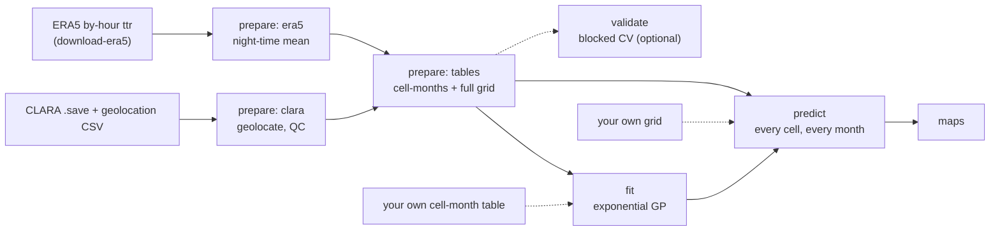

# clara-olr-gapfill

Gap-filled monthly maps of **CLARA (NorSat-1) night-side outgoing longwave radiation (OLR)**, on your own
machine. The tool reads the raw CLARA radiometer files and ERA5. It fits a sparse spatio-temporal Gaussian
process (GP) and predicts every grid cell of every month, with an uncertainty for each value.

The model is the one selected by a blocked cross-validation of three GP kernels: an **exponential kernel** with
ERA5 night-time OLR in the mean function and a calibration step across the 2021–22 CLARA data gap. Its default
settings are those of the reference fit. Everything you might want to change is set in one config file
**before** you run, including the grid resolution (5° by default, 1° or any divisor of 180°), the period, the
QC thresholds and the model settings.

> No data are distributed with this repository. You need the CLARA files from the instrument team and an
> account at the Copernicus Climate Data Store for ERA5. A synthetic demo (`clara-gapfill demo`) checks an
> installation without either.



## Install

Python 3.11 or newer.

```bash
git clone https://github.com/camillandreozzi/clara-olr-gapfill.git
cd clara-olr-gapfill
python -m venv .venv && source .venv/bin/activate
pip install -e ".[maps,era5]"     # maps = Cartopy coastlines, era5 = CDS download client
clara-gapfill demo --quick        # synthetic end-to-end run, about a minute
```

The core install (`pip install -e .`) is enough to fit and predict. Without Cartopy the maps use plain
lat-lon axes. CPU-only PyTorch is all that is needed; no GPU is used.

## Quick start with real data

**1. Put the inputs in place.** Use the same layout as the files from the instrument team, either archives or
extracted files (details in [docs/data.md](docs/data.md)):

```
data/CLARA/CLARA_OLR.tar.gz, CLARA_OLR_2025.tar.gz, ...       monthly IDL .save files (OLR_ALL: JDAY, OLR)
data/CLARA/CLARA_lat_lon_2020.tar.gz, ...                     daily geolocation CSVs
```

**2. Write a config and choose your settings:**

```bash
clara-gapfill init-config my_run.toml     # every setting, commented; delete what you don't change
```

**3. Download ERA5.** You need a [CDS account](https://cds.climate.copernicus.eu/how-to-api) and `~/.cdsapirc`.
The product is "monthly averaged reanalysis by hour of day", native 0.25° grid, about 0.4 GB per year:

```bash
clara-gapfill download-era5 -c my_run.toml
```

**4. Run everything:**

```bash
clara-gapfill run -c my_run.toml
```

The run goes `prepare` → `fit` → `predict` → `maps`. Each stage writes a manifest and is skipped when its
inputs and settings have not changed, so re-running after editing a map setting only redraws the maps. The
results are in `output/res5/exponential/`: `predictions/grid_predictions.csv`, yearly NetCDF files, the monthly
global mean and `maps/<year>/`. See [docs/outputs.md](docs/outputs.md).

## Decide before running: the config

All settings live in [`default_config.toml`](src/clara_gapfill/default_config.toml); your file only needs the
lines you change. Any setting can also be overridden for one run with `--set section.key=value`. The settings
you are most likely to change:

| Setting | Default | What it does |
|---|---|---|
| `grid.res_deg` | `5` | Cell size in degrees for the cell-month means and the predictions. Any integer that divides 180. Outputs go to `res<N>/`, so resolutions never overwrite each other. |
| `time.first_month`, `time.last_month` | `2020-01`, `2026-09` | Period of the training data and of the gap-filled grid. |
| `time.gap_start`, `time.gap_end` | `2021-09`, `2022-05` | The CLARA data gap. With `model.gap_step` the mean function gets a step from `gap_start` on. |
| `qc.night_sza_min`, `qc.vza_max` | `100`, `60` | Night-side and viewing-angle QC of the CLARA samples. |
| `era5.radius_km` | `"auto"` | ERA5 smoothing radius: `auto` picks the best-correlated one of `era5.smoothing_radii_km`. |
| `model.kernel` | `exponential` | The selected kernel. `gaussian` and `matern32` are also available. |
| `model.n_inducing`, `model.restarts` | `1000`, `3` | Size of the sparse approximation and number of optimiser starts. Use `500` and `1` for a quicker fit. |
| `predict.table_format` | `csv` | `parquet` is about 10× smaller, which is useful at 1°. |
| `maps.months` | `"all"` | `"all"`, `"observed"`, or a list such as `["2021-01", "2023-07"]`. |

For example, the same pipeline at 1°, with a quicker fit and maps for two months only:

```bash
clara-gapfill run -c my_run.toml --set grid.res_deg=1 --set model.n_inducing=500 \
    --set model.restarts=1 --set "maps.months=['2021-01','2023-07']"
```

[docs/configuration.md](docs/configuration.md) explains every section and what to expect at other
resolutions.

## Commands

| Command | Does |
|---|---|
| `init-config [file]` | Write the commented default config. |
| `show-config -c file` | Print the resolved settings, including defaults and `--set` overrides. |
| `download-era5 -c file [--dry-run]` | Download ERA5 for the configured period. It resumes, and skips months ERA5 has not published yet. |
| `prepare -c file [--only clara\|era5\|tables]` | Turn raw CLARA + ERA5 into the training table and the gap-free prediction grid. |
| `fit -c file [--table t.csv]` | Fit the GP on every training row. |
| `predict -c file [--model dir] [--grid g.csv] [--out dir]` | Predict every cell of every month. |
| `maps -c file [--predictions dir]` | Draw monthly maps of the predictions, uncertainty, observations and residuals, plus the global mean. |
| `validate -c file [--schemes ...] [--folds ...]` | Run the blocked spatial, temporal and joint cross-validation. This is slow: one fit per fold. |
| `run -c file` | Run prepare, fit, predict and maps, skipping the stages that are up to date. |
| `demo [--quick] [--res N]` | Run the whole pipeline on synthetic data. |
| `import-model full_model.pt --out dir` | Convert a model saved by the original research pipeline. Trusted files only. |

Add `--force` to re-run a stage that is up to date. Set `CLARA_GAPFILL_DEBUG=1` for full tracebacks.

## Shortcuts

- **Your own cell-month table.** `clara-gapfill fit --table cells.csv` skips the CLARA and ERA5 preparation.
  The table needs the columns `lat, lon, year, month` (or `time`), `clara`, `n_overpasses` and `era5_night`
  (or `era5_night_r<R>` columns, one per smoothing radius). The other columns are derived.
- **Your own grid.** `clara-gapfill predict --grid grid.csv --model <dir>` predicts any set of cells and
  months that have ERA5 night-time OLR, for example newly published months.
- **Reuse a fitted model.** A model folder (`model.npz` + `model.json`, no pickle) holds everything needed
  to predict, and no training data. It records the resolution, ERA5 column, time origin and gap definition,
  and `predict` refuses a grid that does not match them.

## The model

For cell-month *i*: *y* is the CLARA monthly-mean radiance, *e* the ERA5 night-time OLR, *s* the post-gap
indicator and *n* the number of CLARA overpasses. The model is

```math
y_i = \beta_0 + \beta_1 e_i + \beta_2 s_i + f(x_i) + \varepsilon_i,
\qquad \varepsilon_i \sim \mathcal{N}\left(0,\ \sigma_0^2 + \sigma_1^2 / n_i\right)
```

The latent field *f* is a zero-mean GP with two additive components: space × season, and space × long-term
time. Each component uses the exponential correlation of a scaled chord distance:

```math
k(x, x') = \sigma_A^2 \exp(-r_A) + \sigma_B^2 \exp(-r_B),\qquad
r_A^2 = \frac{\lVert u - u' \rVert^2}{\ell_{sA}^2} + \frac{\lVert c - c' \rVert^2}{\ell_{season}^2},\qquad
r_B^2 = \frac{\lVert u - u' \rVert^2}{\ell_{sB}^2} + \frac{(t - t')^2}{\ell_{t}^2}
```

The inputs are:
- *u*, the unit vector of the cell centre;
- *c*, a point on the seasonal circle;
- *t*, the time in years.

The model is fitted with the collapsed variational (VFE) bound of Titsias (2009), with 1000 k-means
inducing points, by L-BFGS. All parameters are estimated jointly. [docs/model.md](docs/model.md) gives the
full specification, the prediction and global-mean formulas, and how the kernel was selected.

**Units.** CLARA OLR is a **radiance (W m⁻² sr⁻¹)** and ERA5 OLR a **flux (W m⁻²)**. β₁ converts one into the
other, so all predictions and uncertainties are in CLARA's radiance units. Never subtract the two products
directly.

### Reference results (5°, 2020-01 to 2026-09)

These come from the kernel comparison that selected the model. The CV score is the RMSE in W m⁻² sr⁻¹ (mean
of the per-fold RMSE for each scheme; "primary" is the mean of the three). 37,898 observed cell-months.

| Model | Spatial | Temporal | Joint | Primary |
|---|---|---|---|---|
| **Exponential GP + ERA5 (this tool)** | **36.52** | 43.37 | **38.14** | **39.34** |
| Gaussian GP + ERA5 | 36.69 | **42.80** | 39.05 | 39.51 |
| Matérn 3/2 GP + ERA5 | 36.60 | 44.27 | 38.34 | 39.74 |
| Regression on ERA5, no GP | | | | 40.01 |
| Exponential GP, no ERA5 | | | | 40.68 |

The three kernels are **not statistically distinguishable**: every paired block-bootstrap interval of the RMSE
difference contains 0. The selection rule picked one kernel for the maps; it does not show that the
exponential kernel is better.

Full-data fit:

| Parameter | Value |
|---|---|
| β₀ | 55.49 W m⁻² sr⁻¹ |
| β₁ | 0.546 sr⁻¹ |
| β₂ (gap step) | 13.48 W m⁻² sr⁻¹ |
| σ_A, σ_B | 9.05, 23.62 W m⁻² sr⁻¹ |
| σ₀, σ₁ | 0.004, 45.56 W m⁻² sr⁻¹ |
| Chordal length scales | space A 52.8, season 19.9, space B 8.10 |
| ℓ_t | 3.16 years |
| ERA5 radius | 600 km |

## Caveats

- **Polar-day cells** have no night in the month. They use ERA5's 3 darkest hours instead (`night_fallback`)
  and CLARA never observes them, so their predictions are extrapolation. They are hatched on the maps.
- **The gap months (2021-09 to 2022-05)** are never observed. Their values follow ERA5, the post-gap level and
  the kernel. Kernels that validate equally well differ there: their September 2021 global means differ by
  13 W m⁻² sr⁻¹.
- **Calibration step.** The CLARA/ERA5 ratio rises by about 23 % across the gap. β₂ absorbs a constant step
  only.
- **Length scales.** The fitted chordal length scales exceed 2, the largest chord on the unit sphere. The
  latent field is therefore almost a global offset plus slow drift, and it is reported as chords rather than
  kilometres.
- **Uncertainty.** The latent SD is too small for half-years held out entirely (temporal CV). Read the
  uncertainty maps as a lower bound far from observations in time.
- **CLARA quirks.** The values depend on the viewing angle and are not angle-corrected; the QC keeps VZA ≤ 60°.
  From 2023 about half the footprints are daylit and read higher; the QC keeps the night side only.
- **Resolution.** At 1°, 82 % of cell-months hold a single 30 s sample (22 % at 5°). The 1° detail then comes from ERA5
  through β₁, while the GP stays smooth on its fitted length scales.

## Runtime (laptop, 5°)

| Stage | Time |
|---|---|
| `prepare` | ~1.5 min, including the archive extraction (re-runs at another resolution: under a minute) |
| `fit` with the default settings | about 46 min of CPU time on an Apple-silicon laptop (about 15–25 min on 4 cores); 21 min on 8 cluster cores. `--set model.restarts=1` takes about a third of that |
| `predict` | under a minute (209,952 cell-months) |
| `maps`, every month | about a minute of CPU for the 299 figures |
| `validate`, all 49 folds | one fit per fold: many hours with the default settings, so consider `--set model.restarts=1` |

On macOS, run long fits as `caffeinate -i clara-gapfill run ...` so that idle sleep does not stall them.

## Tests

```bash
pip install -e ".[dev]"
pytest
```

The tests use synthetic data only. They cover:
- the GP against the exact GP;
- the chunked bound against the unchunked one;
- the preprocessing conventions;
- the fold integrity;
- the model files;
- the CLI end to end.

## Citation, licence, acknowledgements

Please cite the software ([CITATION.cff](CITATION.cff)). It is released under the MIT licence
([LICENSE](LICENSE)).

- CLARA (Compact Lightweight Absolute Radiometer) on NorSat-1 was developed by PMOD/WRC, Davos. The CLARA
  data are not part of this repository.
- ERA5: Hersbach et al. (2020), *Q. J. R. Meteorol. Soc.* 146, 1999–2049. Maps made with this tool contain
  modified Copernicus Climate Change Service information.
- Sparse GP bound: Titsias (2009), *Variational learning of inducing variables in sparse Gaussian
  processes*, AISTATS.
